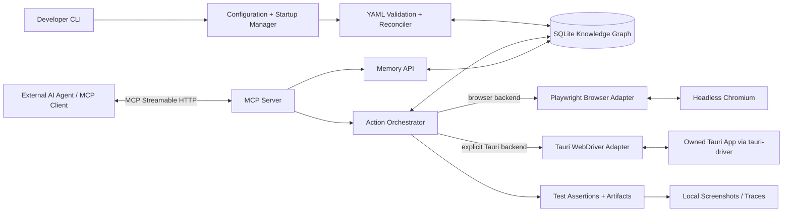

# Product Requirements Document: UI Memory Browser (UMB)

**Version:** 1.0  
**Status:** Implemented product with current capability matrix and remaining backlog
**Date:** 2026-10-11  
**Product type:** Local CLI application, MCP testing service with distinct Playwright browser and managed Tauri app backends
**Primary users:** AI coding agents, QA agents, developers, and automated test orchestrators

## 1. Executive summary

UI Memory Browser (UMB) is a lightweight, local-first application-testing service that AI agents connect to via Model Context Protocol (MCP). Its browser backend uses Playwright for web apps; a separate, explicitly selected Tauri backend controls an owned Tauri app through `tauri-driver`. The product provides useful-surface parity where native semantics support it, not full Playwright API parity. Tauri capabilities are partial; its shipped YAML workflow subset is documented separately from the browser runner. Both backends connect to a persistent SQLite-backed knowledge graph. Users supply declarative YAML describing known screens, UI elements, workflows, preconditions, assertions, and other project knowledge. Startup validates and reconciles YAML-owned knowledge; agents can consult and improve learned knowledge through MCP tools.

**Critical separation of responsibilities:** UMB contains no LLM and requires no AI-provider credentials. An external AI agent interprets page snapshots, plans actions, tests hypotheses, and optionally commits verified findings. UMB supplies tools, stores observations and evidence, and executes deterministic browser operations. The external agent may require its own model access.

The product is not merely a Playwright wrapper; its differentiator is versioned, evidence-backed procedural knowledge that survives across test sessions and helps agents discover and validate application workflows faster. Playwright remains the browser automation technology and `browser_*` remains the browser tool surface; Tauri is a distinct backend with a deliberately bounded capability contract.

## 2. Problem statement

Existing agent/browser systems can navigate a website, click controls, and inspect accessibility trees, but project-specific procedural understanding is often ephemeral. Agents repeatedly rediscover where actions live, which role can access a page, how to complete multistep forms, and what to do after a state changes. Test reliability drops if interface changes invalidate a remembered CSS selector or the agent confuses a previous observation with an invariant.

UMB reduces repeated discovery while keeping browser interactions deterministic, isolated, auditable, and safely recoverable. The Playwright browser surface and bounded Tauri workflow subset are implemented; capability matrices below describe shipped behavior, not full Playwright API parity.

## 3. Goals and non-goals

### 3.1 Goals

- G1. User starts `umb serve` in a terminal; external MCP clients connect to a local endpoint.
- G2. Browser is headless by default, launches locally, and has low orchestration overhead.
- G2a. User can explicitly select an owned Tauri app backend for the useful supported testing surface without changing or routing browser operations through Tauri.
- G3. In the browser backend, the agent can determine current URL, title, accessible page structure, open tabs, available actions, and page errors.
- G4. In the browser backend, the agent can navigate, click, fill, select, scroll, wait, upload files, take screenshots, inspect console/network failures, and run assertions.
- G5. In the browser backend, the agent can request Playwright-style locators and optionally attach a separate Playwright client using an explicitly enabled connection interface.
- G6. User manages a per-project SQLite graph for screens, elements, workflows, transitions, requirements, observations, and test evidence.
- G7. Both browser capabilities and memory search/read/write are exposed through MCP.
- G8. Declarative YAML teaches routes, workflows, roles, and checks and is reconciled on *every* startup.
- G9. Verified knowledge survives restarts. Invalid or outdated facts are marked stale rather than silently trusted.
- G10. No AI provider SDK, keys, or external model inference required for UMB to operate.
- G11. Share workflow knowledge and reporting across backends only where semantics are supported; unsupported actions fail preflight rather than silently falling back to another backend.

### 3.2 Non-goals for MVP

- Bundled agent orchestration or autonomous planning; the connecting agent does this.
- Hosting or training a local language model.
- Cloud synchronization or multi-user collaboration.
- Mobile apps, desktop frameworks other than the specifically supported Tauri path, arbitrary attachment to user-owned desktop processes, and complete Playwright API parity on Tauri.
- Cross-browser matrix (Firefox/WebKit), distributed testing, or high-scale concurrency.
- General-purpose graph database engine or arbitrary externally supplied SQL execution.
- Learning from screenshot pixels without the external agent's vision capabilities.
- Automatically accepting unverified observations as canonical knowledge.

## 4. Personas and user stories

**Developer/QA engineer:** As a developer, I can configure a project, start a local server, connect my existing AI coding agent, ask it to test a feature, and inspect evidence of failures.

**AI testing agent:** As an agent, I can identify my page and current capabilities, recall how to reach a screen, execute a workflow, validate its outcome, and save new verified steps without needing to rediscover them next time.

**Project maintainer:** As a maintainer, I can seed the knowledge graph with source-controlled YAML, correct an incorrect learned procedure, and retain provenance between developer-authored and discovered knowledge.

## 5. Core operational flow

1. User creates a project configuration and a directory of YAML knowledge files.
2. User launches `umb serve --config ./umb.config.yaml`.
3. UMB validates config, acquires project-scoped file/database lock, opens/migrates SQLite, recursively scans the configured YAML directory, validates all YAML, computes file hashes, and transactionally reconciles knowledge.
4. UMB launches the isolated headless Chromium browser backend. The user separately opts into Tauri tools and explicitly invokes operations on its owned configured managed app session; the two tool families do not silently switch backends. Workflow failure evidence never auto-starts a desktop session.
5. UMB binds MCP Streamable HTTP to `127.0.0.1` and announces the endpoint and configured project to stderr/terminal.
6. User configures external MCP client with the HTTP endpoint (or optionally uses `umb mcp --stdio` for client-launched mode).
7. Agent calls `project_context`, `browser_status`, `memory_recall`, `browser_snapshot`, etc.; it navigates and tests through MCP.
8. UMB logs events and candidate observations. Agent explicitly validates and promotes findings to reusable learned graph knowledge; confirmed assertions can provide machine-verifiable evidence.
9. Agent can request graph queries, confidence and provenance, and execute known workflows step-by-step or deterministically using the workflow runner.
10. Restart repeats YAML reconciliation without destroying learned data.

## 6. System architecture



### Technology decisions

- **Runtime:** Node.js with TypeScript (current supported LTS; pin exact major at implementation).
- **Browser backend:** Playwright-managed Chromium in headless mode. The existing `browser_*` contract is Playwright-backed and remains browser-only. Download browsers on explicit `umb install browser` command or validated first-run prompt; avoid silently downloading in CI.
- **Tauri backend:** separate, opt-in `tauri-driver` service for a configured app binary and owned managed session. It is not a Playwright adapter and must not imply browser navigation, tab, locator, or assertion semantics it does not implement.
- **MCP:** Official TypeScript SDK, Streamable HTTP as primary transport; optional stdio mode.
- **Database:** SQLite in WAL mode, foreign keys enabled, versioned migrations, standard `nodes` and `edges` tables, structured attributes as JSON and indexed columns, SQLite FTS5 for keyword search when available.
- **YAML:** Safe YAML parser plus explicit schema validation, reject duplicate keys, disallow arbitrary executable tags, validate references and topological consistency.
- **CLI:** A typed command-line framework; structured diagnostics to stderr.
- **Testing assertions:** Playwright locator/expect semantics (or equivalent internal assertion engine); event logs and optional Playwright tracing.
- **Packaging:** npm executable initially; explore single-binary packaging only after benchmarking.

**Lightweight means lean orchestration, not a tiny browser engine.** Modern web apps need Chromium-level HTML/CSS/JS/Web APIs. Reusing one browser process and isolated contexts minimizes overhead; a minimal HTTP client cannot test modern interactive apps reliably.

## 7. Requirements (priority / acceptance criteria)

| ID | Priority | Requirement | Acceptance criterion |
| --- | --- | --- | --- |
| CLI-01 | P0 | Start/stop local server | `umb serve --config path` starts; Ctrl-C closes browser, DB, and listener gracefully. |
| CLI-02 | P0 | Health diagnostics | `umb doctor` verifies browser, DB, schema, YAML, and MCP configuration with exit codes. |
| CLI-03 | P0 | Project isolation | Distinct project IDs have separate databases, artifacts, browser contexts, locks. |
| MCP-01 | P0 | HTTP MCP endpoint | Remote MCP client on same machine can list/call tools and read resources. |
| MCP-02 | P0 | Discoverable tool contracts | Each tool publishes validated input schema, purpose, and structured errors. |
| BROWSER-01 | P0 | Headless Chromium | Headless is default; headed optional diagnostic flag. |
| BROWSER-02 | P0 | State introspection | Agent gets URL, title, tab ID, loading state, visible interactables, and summary. |
| BROWSER-03 | P0 | Interaction | Navigate, click, type, fill, select, keyboard, scroll, wait, back/forward, tab handling. |
| BROWSER-04 | P0 | Accessibility-first snapshot | Compact accessibility tree with role, name, state, and short-lived element references. |
| BROWSER-05 | P0 | Locator actions | Support `role/name`, `label`, `placeholder`, `testId`, `text`, and scoped CSS selectors. |
| BROWSER-06 | P0 | Stable errors | On stale/ambiguous locator, return diagnostic and nearby candidate references, not arbitrary click. |
| TEST-01 | P0 | Deterministic assertions | Verify visible/hidden, enabled, text, URL, count, form value, element presence. |
| TEST-02 | P0 | Failure evidence | Save redacted screenshot, current snapshot, error, action sequence, timestamps. |
| MEMORY-01 | P0 | Per-project persistent graph | Nodes/edges survive restarts and can be exported to JSON. |
| MEMORY-02 | P0 | Search and recall | Recall by page route, goal, role, workflow, text, and graph relation. |
| MEMORY-03 | P0 | MCP graph tools | Read, propose, validate, supersede, and list related nodes/edges. |
| MEMORY-04 | P0 | Evidence + provenance | Every learning stores source, verification status, timestamps, scope, and evidence refs. |
| YAML-01 | P0 | Startup scan | All YAML under configured root scanned and hash checked every start. |
| YAML-02 | P0 | Controlled reconciliation | YAML changes update YAML-owned records; learned records persist; absent YAML tombstoned. |
| YAML-03 | P0 | Validation safety | Invalid YAML aborts reconciliation with clear diagnostics and preserves last valid DB state. |
| SECURITY-01 | P0 | Local-only transport | Listener defaults to `127.0.0.1`, with configurable token for HTTP access. |
| SECURITY-02 | P0 | Input boundaries | Optional domain allowlist, path restrictions, action permissions, secrets redaction. |
| API-01 | P1 | Playwright client attachment | Explicit opt-in endpoint allows compatible external Playwright client to attach to a browser server. |
| TEST-03 | P1 | Declarative workflow replay | Replay a stored flow with preconditions, assertions, retries, and per-step logs. Backend-specific supported subsets are explicit; unsupported Tauri steps fail preflight without browser fallback. |
| TAURI-01 | P1 | Explicit Tauri backend selection | Select Tauri only through explicit configuration/requested backend; browser operations remain Playwright-backed and do not start or attach to arbitrary desktop processes. |
| TAURI-02 | P1 | Portable workflow subset | Preflight and execute only the documented Tauri-supported YAML subset; unsupported steps return a bounded incompatibility before side effects. |
| TAURI-03 | P1 | Equivalent bounded outcomes | For supported actions/assertions, report step outcome, timing, and linked artifacts with the same workflow-level result shape; do not claim unsupported browser semantics. |
| BROWSER-07 | P1 | Extra introspection | Console errors, failed network requests, screenshot, downloadable trace. |
| MEMORY-05 | P1 | Proposed self-healing | Return alternate locators based on graph evidence; agent confirms, never blindly rewrite. |
| MEMORY-06 | P1 | Explainable graph routes | Query paths between screens, prerequisite authentication, role constraints. |
| CLI-04 | P1 | Watch/reload YAML | `umb knowledge reload` and optional watch mode, validated atomically. |
| API-02 | P2 | Multi-engine support | Firefox/WebKit after core Chromium is reliable. |
| TEST-04 | P2 | Generate Playwright spec | Export verified workflow as runnable Playwright test source. |

## 8. MCP interface contract

All tools return machine-readable result objects with `{ ok, project_id, session_id, data?, error?, evidence_refs?, state_revision? }`. Each stateful browser mutation increments a revision; tools optionally accept `expected_revision` for concurrency protection. A failed action never automatically implies a successful test.

### 8.1 Browser tool catalogue (MVP)

| Tool | Inputs | Result |
| --- | --- | --- |
| `browser_status` | `{}` | Active tab, URL, title, load state, session, tabs, pending dialogs, last error. |
| `browser_navigate` | `{url, wait_until?, timeout_ms?}` | Final URL, title, revision, optional snapshot. |
| `browser_snapshot` | `{mode?: interactive|compact|full, depth?, scope?}` | Accessibility text plus ephemeral element references. |
| `browser_find` | `{text?, role?, name?, selector?}` | Matching elements with evidence and ref. |
| `browser_click` | `{target, expected_revision?}` | Click outcome and updated state. |
| `browser_fill` | `{target, value}` | Field confirmation, redacted if secret. |
| `browser_press` | `{key, target?}` | Keypress outcome. |
| `browser_select` | `{target, values}` | Selected values. |
| `browser_scroll` | `{direction, amount?, target?}` | Scroll position / state. |
| `browser_wait_for` | `{condition, target?, timeout_ms?}` | Condition match or timeout. |
| `browser_tabs` | `{}` | Available tabs and current tab. |
| `browser_tab_select` | `{tab_id}` | Activated tab state. |
| `browser_back` / `browser_forward` | `{}` | Navigation result. |
| `browser_screenshot` | `{full_page?, path?}` | Artifact path/resource URI (inside permitted root). |
| `browser_errors` | `{since_revision?}` | Relevant console/page/network errors, redacted. |
| `browser_close_session` | `{session_id?}` | Shutdown confirmation. |

Targets accept the current snapshot ref or a typed persistent locator object. Snapshot refs are temporary; durable memory must store semantic locators and fallbacks, never only snapshot refs.

Suggested locator shape: `{ "by": "role", "role": "button", "name": "Save", "exact": true }`. Other modes include `label`, `placeholder`, `test_id`, `text`, and `css`; chained locators and frame scope are P1. Locator resolution first requires uniqueness and visibility; ambiguous matches fail safely.

### 8.2 Test tools

| Tool | Purpose |
| --- | --- |
| `test_assert` | Apply a deterministic condition and report PASS/FAIL with evidence. |
| `test_run_workflow` | Execute stored declarative steps through the Playwright browser runner. |
| `test_report` | Retrieve run summary, step timing, failed assertions, artifacts. |

`test_run_workflow` executes through the Playwright browser runner. Its optional `desktop_screenshot` failure evidence is diagnostic only, not desktop workflow execution. The separate `desktop_run_workflow` executes only its documented subset against an already-running owned session and exact session ID; it never auto-starts or falls back, and rejects unsupported semantics in preflight.

### 8.3 Memory/knowledge tools

| Tool | Purpose |
| --- | --- |
| `memory_context` | Return project metadata, relevant known screens, tasks, roles, and recent learnings. |
| `memory_recall` | Rank workflow and UI knowledge by goal, current URL, role, and state. |
| `memory_get_node` | Retrieve node, provenance, confidence, observations, connected edges. |
| `memory_neighbors` | Get typed outgoing/incoming edges, with bounded depth and filtering. |
| `memory_path` | Find shortest allowed navigation path between known screens. |
| `memory_search` | Search graph metadata/content with keyword FTS and filters. |
| `memory_propose` | Submit candidate node/edge/workflow; store as unverified. |
| `memory_verify` | Promote evidence-backed candidate after assertions or authorized human review. |
| `memory_supersede` | Replace stale learning and preserve history. |
| `memory_record_outcome` | Link an action/workflow attempt with result, evidence, and environment. |
| `memory_export` | Export sanitized graph in JSON format. |
| `memory_stats` | Counts, verified/stale nodes, last import, evidence coverage. |

No raw SQL execution through MCP in MVP. MCP resources provide `umb://project/current`, `umb://browser/current`, `umb://memory/screen/{id}`, `umb://memory/workflow/{id}`, `umb://runs/{run_id}`. Resource templates should expose only available project scope.

## 9. SQLite knowledge graph

SQLite is not a native graph database, but typed node and edge tables plus recursive CTEs are sufficient for the small-to-medium project navigation graph. No Neo4j service is necessary.

### 9.1 Schema (conceptual, migration-controlled)

- `projects(id, name, base_url, created_at, updated_at)`
- `nodes(id, project_id, type, stable_key, display_name, route_pattern, attributes_json, origin, verification_status, confidence, created_at, updated_at, last_verified_at, superseded_by, content_hash)`
- `edges(id, project_id, from_node_id, to_node_id, relation_type, attributes_json, origin, verification_status, confidence, updated_at, last_verified_at)`
- `workflows(id, project_id, stable_key, display_name, version, source_node_id, destination_node_id, role, requirements_json, created_at, updated_at)`
- `workflow_steps(id, workflow_id, step_number, action_type, target_json, value_reference, timeout_ms, assertion_json, on_failure)`
- `observations(id, project_id, session_id, page_url, event_type, proposed_node_id, payload_json, outcome, observed_at)`
- `evidence(id, project_id, run_id, observation_id, kind, artifact_path, metadata_json, created_at)`
- `runs(id, project_id, session_id, workflow_id, started_at, finished_at, status, environment_json)`
- `yaml_sources(id, project_id, canonical_path, content_hash, imported_at, status, last_error)`
- `yaml_ownership(project_id, source_id, entity_type, entity_id, source_key, source_hash)`
- `schema_migrations(version, applied_at)`
- `memory_audit(id, project_id, actor, operation, entity_type, entity_id, old_json, new_json, created_at)`

Unique keys: `(project_id, type, stable_key)` for nodes; configured identity for edges; `(workflow_id, step_number)` for steps. Enforce foreign keys, indexes on project/type/key/route/status and edge endpoints. FTS5 index on node names, routes and text attributes with appropriate insert/update/delete synchronization.

### 9.2 Graph types

**Node types:** `application`, `screen`, `ui_element`, `action`, `workflow`, `role`, `state`, `requirement`, `assertion`, `issue`, `api_endpoint` (future), `test_data` (metadata only).

**Edge types:** `HAS_SCREEN`, `CONTAINS`, `NAVIGATES_TO`, `TRIGGERED_BY`, `REQUIRES_ROLE`, `REQUIRES_STATE`, `USES_ELEMENT`, `EXECUTES`, `ASSERTS`, `LEADS_TO`, `RELATED_TO`, `SUPERSEDES`, `EVIDENCED_BY`.

Example graph: `Login screen` —CONTAINS→ `Email textbox` / `Password textbox` / `Sign in button`; `Login workflow` —EXECUTES→ `Fill email` → `Fill password` → `Click sign in`; `Login workflow` —LEADS_TO→ `Dashboard`; `Dashboard` —REQUIRES_ROLE→ `Authenticated user`.

### 9.3 Provenance and confidence

Each fact records `origin`: `yaml`, `agent`, `observation`, or `human`; `verification_status`: `proposed`, `verified`, `stale`, `rejected`, `superseded`; `confidence`: float 0–1; and evidence references. A confidence score is a heuristic used for ranking, not proof of truth.

Recommended policy:

- YAML facts are **authored**, not necessarily observed; mark `verified` only when associated deterministic checks pass, otherwise `authored` provenance plus `proposed`/`trusted_source` state if supported.
- A browser observation is stored as `proposed`, not directly used as a hard-coded test oracle.
- Deterministic assertions or explicit maintainer approval may mark a candidate verified.
- Repeated successful outcomes raise ranking; repeated failures lower ranking and suggest staleness.
- UI version, route, role, locale, viewport, and browser context form the scope of a learning.
- Superseded records retain history; failed assertions do not overwrite source-controlled YAML without user change.
- Sensitive input values, passwords, tokens, cookies, personal records, and whole-page snapshots are not stored in graph attributes by default.

### 9.4 Recall algorithm

Given `(goal, current_url, role, page_signature)`:

1. Resolve matching project and current screen via normalized route pattern + visible landmarks.
2. Search matching verified workflows and related node names via indexed route lookup and FTS5 keyword search.
3. Traverse `NAVIGATES_TO`, `REQUIRES_ROLE`, `REQUIRES_STATE`, and workflow edges to propose viable paths.
4. Rank by verified status, source, evidence, environment/role match, recent success rate, freshness, and path length.
5. Return top 3 procedural candidates with human-readable steps, locator fallbacks, preconditions, citations to local evidence IDs, and explicit uncertainty.
6. If candidates fail, re-snapshot, try alternative semantic locator after uniqueness checks, and propose a correction for agent/human verification.

Do not require embeddings, an embedding model, or an external model API in MVP. FTS5 plus structured graph traversal and route matching is adequate initially. Optional local embeddings can be evaluated later.

## 10. YAML knowledge system

### 10.1 Source layout

```text
my-web-app/
  umb.config.yaml
  .umb/
    memory.sqlite
    artifacts/
    browser-profiles/
  umb-knowledge/
    app.yaml
    roles/
      admin.yaml
    screens/
      login.yaml
      dashboard.yaml
    workflows/
      login.yaml
      create-project.yaml
    rules/
      navigation.yaml
```

**Important:** Add `.umb/` to `.gitignore`; commit `umb-knowledge/` to version control. No secrets in YAML. Keep credentials in environment variables or a dedicated local secret mechanism.

### 10.2 Config format (`umb.config.yaml`)

```yaml
version: 1
project:
  id: demo-web
  name: Demo Web App
  base_url: http://127.0.0.1:3000
server:
  transport: streamable-http
  host: 127.0.0.1
  port: 7317
  auth:
    mode: token
    token_env: UMB_MCP_TOKEN
browser:
  engine: chromium
  headless: true
  viewport: { width: 1440, height: 900 }
  profile: ephemeral
  max_contexts: 1
  download_policy: deny
  allowed_origins:
    - http://127.0.0.1:3000
memory:
  database: ./.umb/memory.sqlite
  learning_mode: reviewed
  capture_observations: true
  store_page_content: false
knowledge:
  path: ./umb-knowledge
  recursive: true
  check_on_startup: true
  remove_missing_yaml: tombstone
  validation: strict
  watch: false
artifacts:
  directory: ./.umb/artifacts
  redact_secrets: true
```

Server authentication defaults should require a token for manually started HTTP mode (generated and shown securely on setup); an explicit localhost-only unauthenticated developer override may be permitted with warning.

### 10.3 Common YAML document contract

All documents contain `schema_version: 1`, `kind`, `id`, `name`, and kind-specific fields. IDs must be stable and project-unique within a kind; references are `kind:id`. A strict JSON Schema or equivalent validator rejects unknown fields unless explicitly designated extensibility metadata.

#### Application (`app.yaml`)

```yaml
schema_version: 1
kind: application
id: demo-web
name: Demo Web App
base_url: http://127.0.0.1:3000
start_screen: screen:login
route_patterns:
  - screen: screen:login
    path: /login
  - screen: screen:dashboard
    path: /dashboard
```

#### Role (`roles/admin.yaml`)

```yaml
schema_version: 1
kind: role
id: admin
name: Administrator
permissions:
  - project.read
  - project.create
  - user.manage
```

#### Screen (`screens/login.yaml`)

```yaml
schema_version: 1
kind: screen
id: login
name: Sign-in page
route: /login
landmarks:
  - locator: { by: role, role: heading, name: Sign in }
elements:
  - id: email
    description: Email address input
    locator: { by: label, value: Email }
    fallback_locators:
      - { by: test_id, value: login-email }
    sensitive: false
  - id: password
    description: Password input
    locator: { by: label, value: Password }
    sensitive: true
  - id: submit
    description: Sign-in button
    locator: { by: role, role: button, name: Sign in }
actions:
  - id: submit-login
    element: submit
    effect: { navigates_to: screen:dashboard }
```

#### Workflow (`workflows/login.yaml`)

```yaml
schema_version: 1
kind: workflow
id: login
name: Sign in as a test user
start_screen: screen:login
end_screen: screen:dashboard
requires:
  role: role:admin
  environment:
    - local
    - staging
variables:
  email: { from_env: UMB_TEST_EMAIL, sensitive: true }
  password: { from_env: UMB_TEST_PASSWORD, sensitive: true }
steps:
  - id: open-login
    action: navigate
    path: /login
  - id: enter-email
    action: fill
    target: { screen: login, element: email }
    value: ${{ variables.email }}
  - id: enter-password
    action: fill
    target: { screen: login, element: password }
    value: ${{ variables.password }}
  - id: sign-in
    action: click
    target: { screen: login, element: submit }
  - id: confirm-dashboard
    action: assert
    condition: url_matches
    pattern: /dashboard
  - id: confirm-heading
    action: assert
    condition: visible
    target: { by: role, role: heading, name: Dashboard }
on_failure:
  capture: [snapshot, screenshot, console_errors]
  stop: true
```

`value: ${{ variables.email }}` is a literal template expression interpreted **only** by UMB's allowlisted variable resolver. Implement no JS evaluation or shell expansion. Never echo resolved sensitive values to logs, tool results, or SQLite.

#### Navigation rules (`rules/navigation.yaml`)

```yaml
schema_version: 1
kind: navigation_rules
id: core-navigation
rules:
  - id: projects-from-dashboard
    from: screen:dashboard
    to: screen:projects
    via:
      action: click
      target: { by: role, role: link, name: Projects }
    preconditions:
      - { state: authenticated }
    verify:
      condition: url_matches
      pattern: /projects
```

### 10.4 Startup reconciliation

- Resolve canonical knowledge root; reject directory escapes/symlink escapes unless explicitly configured.
- Recursively enumerate `*.yaml` and `*.yml` in deterministic, normalized path order.
- Parse using restricted YAML settings; reject duplicate keys, excessive aliases, overly large files, or unknown tags.
- Validate each document against versioned schema; validate duplicate IDs, references, workflow steps, and action allowlist.
- Hash normalized content; compare to `yaml_sources`.
- Build staging changes and generate a dry-run import summary.
- In one DB transaction, upsert changed YAML-owned entities and their edges/steps, preserve agent-created records, and mark deleted YAML-owned records as tombstoned (history preserved).
- If a YAML fact contradicts a learned fact, preserve both with provenance and mark the learned record as conflict/stale; expose conflict to MCP.
- If any file fails validation, leave the previous valid graph unchanged and fail startup by default. Optional `--allow-stale-knowledge` starts in explicitly degraded read-only-knowledge mode.
- Record import audit including hashes and changed entity IDs; emit count summary.
- On every startup, perform at least a hash scan even when no changes are present. Do not depend solely on filesystem watch events.

## 11. Learning behavior and browser knowledge

**Three levels of data:**

1. **Observed:** facts from browser events, page snapshots, locator outcomes, and assertions (short-term evidence).
2. **Candidate learning:** agent-proposed meaning from observations, linked to preconditions and proof.
3. **Verified knowledge:** replayed assertions or maintainer-approved facts that are safe to prioritize for future agent recalls.

**Example:** An agent is tasked with creating a new event. It recalls `Create event` workflow, but the expected `New Event` button has moved to an overflow menu. It takes a compact snapshot, finds the new menu, navigates successfully, asserts that the event editor is visible, submits a new route proposal, and links a screenshot/assertion as evidence. The old locator is marked stale only after verification. On subsequent runs the corrected path ranks first.

**Memory boundaries:** Browser ref `e42`, DOM node IDs, browser tab handles, volatile session cookies, and raw passwords must not become long-lived application graph facts. Store semantic locators, route patterns, roles, validated preconditions, and evidence instead.

## 12. Execution backends and useful capability parity

UMB preserves distinct adapters. `browser_*` and `test_run_workflow` remain Playwright-backed. Tauri uses a separate explicitly selected, owned `tauri-driver` session and `desktop_run_workflow`. Status vocabulary describes **UMB's shipped surface**, not full Playwright API parity: **FULL** = UMB's useful capability is implemented and observable; **PARTIAL** = only the stated subset or runtime-constrained surface exists; **UNSUPPORTED** = no UMB operation; **NOT_APPLICABLE** = no meaningful equivalent.

| Capability | Playwright/browser status + observable scope | Desktop/Tauri status + observable scope | Gap / notes |
| --- | --- | --- | --- |
| Lifecycle / engine | PARTIAL — configurable Chromium/Firefox/WebKit and managed browser session. | PARTIAL — configured Tauri binary and owned `tauri-driver` session/lifecycle. | No arbitrary desktop attach; independent runtimes. |
| Navigation / history / tabs | FULL — origin/redirect restrictions, navigation, back/forward, tabs and selection. | UNSUPPORTED for direct navigation/history; NOT_APPLICABLE for tabs. | UI-driven state changes are not direct navigation; no desktop tab model. |
| Viewport / window size | FULL — set browser viewport dimensions. | PARTIAL — resize managed Tauri window; backend/compositor may refuse; capture profiles restore the prior window rect. | Browser viewport and native window geometry are not identical. |
| Locators / discovery | FULL — role/name, label, placeholder, test ID, text and CSS locators; semantic discovery and ephemeral refs. | PARTIAL — direct desktop MCP supports CSS plus exact role/name and `data-testid` targets; tree/details remain bounded. | Role/name is a limited DOM approximation: explicit role or a small tag fallback; name is trimmed `aria-label`, else `innerText`, else `alt`, capped at 300 characters. Exact, case-sensitive comparison; not full ARIA accessible-name computation. Semantic actions require one visible, enabled target. Label/placeholder/text and semantic Tauri YAML targets remain unsupported. |
| Interactions | FULL — click/fill/type/press/select/keyboard/scroll/upload. | PARTIAL — direct tools provide click/type/global keypress/upload; workflows provide click/type/scroll. | No desktop fill/select; upload is direct-tool-only. Workflows have no press/keypress/upload. WebKitGTK behavior varies by build. |
| Waits / assertions | FULL — broader waits and assertions including URL/count/value, element state and text. | PARTIAL — waits present/visible/hidden/enabled; assertions for these plus exact/contains text. | No desktop URL/count/value conditions. |
| YAML workflow | FULL — `test_run_workflow` runs through Playwright, including supported navigation, screens, pre/postconditions, actions, waits, assertions and failure captures. | PARTIAL — explicit `desktop_run_workflow`: CSS targets; click/type/scroll; waits present/visible/hidden/enabled; assertions for those and exact/contains text. | No desktop screens, routes/navigation, press, fill/select/upload, URL/count/value, browser-only locators or browser diagnostics. Preflight rejects unsupported semantics before effects; exact already-running owned session ID required; never auto-starts/falls back. |
| Screenshots / visual evidence / masks | PARTIAL — viewport/full-page screenshots and managed artifacts. | PARTIAL — opt-in screenshot capture; visual baselines/comparisons/findings implemented. | Browser workflows can capture screenshots/diagnostics; the managed baseline/diff/finding loop is desktop-only. Auth workflows suppress capture. Desktop masks are narrow configured top-level DOM overlays, not general PII redaction. |
| Upload | PARTIAL — <=20 MiB project-contained regular file to a unique file input. | PARTIAL — direct `desktop_upload` only: one project-relative regular file (<=20 MiB) to a unique enabled `input[type=file]` in an already-running managed session. | W3C Element Send Keys only; no chooser/JavaScript assignment; reject traversal, symlink escape, and CR/LF paths; return basename/size only. Any configured high-risk `upload`/`any` rule blocks all desktop uploads because no approval prompt is available. Not a YAML workflow action. Native acceptance passed only on Fedora 44 WebKitGTK/WebKitWebDriver 2.54.1-1.fc44. |
| Diagnostics | PARTIAL — opt-in metadata-only console/page/request/HTTP diagnostics. | PARTIAL — status/tree/details and screenshot evidence, no console/network diagnostics. | No general network interception, download API or trace. |
| Accessibility | PARTIAL — accessibility-oriented snapshots and semantic locators. | PARTIAL — bounded DOM-derived tree/details. | ARIA snapshot is partial, not a dedicated a11y audit; no desktop audit. |
| Run / evidence / security | PARTIAL — managed workflow records/artifacts and origin/redirect restrictions; configured high-risk targets require local approval and fail closed if denied/unavailable. | PARTIAL — separate workflow and visual evidence artifacts, explicit baseline gates; matching high-risk mutation rules fail closed without prompting. | Failure capture requires an existing service; auth capture suppressed. No automatic finding/memory writeback. |
| Platform / runtime | PARTIAL — configurable Chromium/Firefox/WebKit; installed runtime dependent. | PARTIAL — Tauri workflow interaction acceptance passed Fedora 44 WebKitGTK/WebKitWebDriver 2.54.1-1.fc44. | Other runtimes not generalized. X11 capture requires exact title, `wmctrl`, ImageMagick; Wayland window capture and Windows native window capture unsupported. |

Browser evidence: MCP/controller `src/mcp/server.ts:413-459`, `src/browser/controller.ts:15-65`; workflow schema/runner `src/workflow/contract.ts:8-53` and `src/workflow/runner.ts`. Tauri evidence: MCP tools `src/mcp/server.ts:263-310,435-457`; driver `src/workflow/desktop-driver.ts:17-94,149-173`; service `src/desktop/index.ts:198-216,238-361,385-460`.

### 12.1 Shipped Tauri YAML workflow subset

The explicit `desktop_run_workflow` tool and Tauri adapter are implemented. It accepts CSS targets; `click`, `type`, and `scroll`; waits for present/visible/hidden/enabled; and assertions for those states plus exact/contains text. Preflight rejects start/end screens, route/navigation, `press`, `fill`/`select`, URL/count/value conditions, semantic locator targets (including role/name and test_id), browser refs, upload, and browser diagnostics before effects. Direct desktop MCP locators and `desktop_upload` do not expand this YAML workflow subset. High-risk workflow mutation rules fail closed rather than prompting for approval. The workflow tool requires an already-running UMB-owned desktop session and exact session ID; it never auto-starts a session or falls back to Playwright. `browser_*` and `test_run_workflow` remain Playwright-backed.

Phase 3C shipped at commit `b16cf50`; Gate 3C passed for the tested runtime. This is runtime-specific acceptance, not a claim about every WebKitGTK build. Remaining capability gaps are tracked in the backlog below.

### 12.2 Playwright browser support

- **P0:** Internally use Playwright's `Browser`, `BrowserContext`, `Page`, `Locator`, navigation, events, and assertions for the browser backend. Existing `browser_*` MCP tools map to browser APIs only.
- **P0:** Browser locator specification supports role/name, label, placeholder, test ID, text, and scoped CSS. No arbitrary JavaScript evaluation via MCP by default.
- **P1:** Expose opt-in `umb playwright endpoint` capability backed by a Playwright-launched browser server. Require compatible Playwright client versions and local binding/authentication. BrowserType `connect()` provides higher fidelity than attaching via CDP.
- **P1:** Optionally attach UMB to an existing local Chromium browser via `connectOverCDP()` for diagnostics only; document fidelity limitations.
- **P2:** Generate a standalone Playwright `.spec.ts` from a verified browser workflow; emitted source must be reviewed/owned by the project.

Multiple MCP sessions may use the process's shared browser page. Globally serialize each browser operation (and each workflow/assertion run as a unit), but make clear that separate clients share page state and their sequences are not isolated or transactional. Clients should provide the current `expected_revision` on mutations where supported to reject stale changes. MCP sessions expire independently after five minutes without requests. The optional Playwright endpoint launches a separate browser and admits one external client at a time; project locking prevents it from running concurrently with the MCP server for the same project. Tauri session operations remain a separate owned-service lifecycle.

## 13. CLI and startup UX

```bash
# Bootstrap config and knowledge files
umb init --project demo-web --url http://127.0.0.1:3000

# Install browser binary / validate dependencies
umb install browser
umb doctor --config ./umb.config.yaml

# Run server manually; MCP client connects afterward
umb serve --config ./umb.config.yaml

# Optional: MCP client launches a stdio subprocess instead
umb mcp --stdio --config ./umb.config.yaml

# Knowledge lifecycle tools
umb knowledge validate
umb knowledge import --dry-run
umb knowledge reload
umb memory stats
umb memory export --format json --output ./graph-export.json
```

Example terminal banner (stderr, not MCP stdout):

```text
UI Memory Browser v1.0.0
Project: demo-web
Browser: Chromium (headless)
Knowledge: 11 YAML files, 4 updated, 0 invalid
Memory: ./.umb/memory.sqlite (205 nodes, 311 edges)
MCP: http://127.0.0.1:7317/mcp
Ready. Press Ctrl-C to stop.
```

A generic MCP client config in URL-capable clients can be equivalent to:

```json
{
  "mcpServers": {
    "umb": {
      "url": "http://127.0.0.1:7317/mcp"
    }
  }
}
```

Specific clients differ in the names and shapes of HTTP MCP configuration fields. Token-bearing clients should use an `Authorization: Bearer ...` header from their secure configuration; never embed tokens in the URL.

## 14. Safety, privacy, and resilience

- Bind local HTTP interface to loopback by default; require authentication if exposed beyond a trusted local environment; validate `Origin` and Host for local MCP endpoints.
- Allowlist target origins; reject or require explicit permission for cross-origin navigation, downloads, file URLs, external uploads, and sensitive actions.
- Designate potentially destructive operations (`delete`, `publish`, `pay`, `send`, `bulk edit`) as approval-gated based on workflow policy. Browser button labels are insufficient authority to perform them.
- Treat website content as untrusted. Ignore webpage prompts instructing the agent to export secrets, access another project, or override MCP permissions. Host-agent must enforce same trust boundary.
- Redact passwords, credentials, session tokens, PII, and sensitive form values from logs, network bodies, and SQLite. Desktop selector masks only overlay explicitly selected visible WebView DOM regions; they are not general PII/pixel redaction and do not cover native UI, all pixels, iframes, or shadow DOM.
- Artifact path traversal protection; enforce quotas, retention, and secure permissions. Screenshots can still contain sensitive information; opt-in or redacted storage may be necessary.
- Store authentication state only in protected, ignored local paths; support clean ephemeral contexts by default.
- SQLite WAL, migrations, transactions, backups, integrity checks, and graceful shutdown. Do not enable unsafe raw SQL on MCP.
- Cap browser session count, timeouts, network capture, payload sizes, and snapshot depth to avoid resource exhaustion.
- Distinct tests should use isolated browser contexts and test accounts when they mutate server-side data.

## 15. Performance and acceptance targets

These are **design targets to benchmark**, not claims about existing measurements:

- P0: Start MCP/control-plane components in <=2 seconds on a typical modern developer computer, *excluding browser download*; separately measure Chromium launch.
- P0: Take compact accessibility snapshot from a representative medium-complexity local page in <=500 ms at p95 on benchmark hardware.
- P0: Reconcile 100 unchanged small YAML files in <=1 second after SQLite migrations on benchmark hardware.
- P0: Memory recall from a graph of 10,000 nodes and 30,000 edges in <=250 ms at p95 for indexed queries.
- P0: 100 consecutive deterministic commands complete without session corruption on smoke-test application.
- P0: Graph and authored YAML knowledge persist across 10 restarts; no duplicate stable nodes on repeated imports.
- P0: A stale locator returns a clear recoverable error, never silently clicks the first match.
- P0: A failed YAML import causes no partial mutations.
- P0: 0 provider API key requirements or network AI inference calls.
- P1: Verified workflow replay passes >=95% across 30 unchanged runs on a stable, deterministic test fixture; investigate flaky tests rather than weaken assertions.

## 16. Acceptance scenarios / demonstration

1. **Fresh-project onboarding:** initialize UMB, edit config, launch server, and connect an external MCP agent by URL.
2. **No model credentials:** run UMB on an offline machine with preinstalled Chromium and no AI-related environment variables; MCP tools still work.
3. **Page awareness:** agent retrieves URL/title/accessibility snapshot and identifies available buttons/forms.
4. **Guided login:** authored YAML describes login; agent recalls it, obtains test credentials from environment through allowed variable references, executes login, and verifies dashboard.
5. **New learning:** agent discovers `Create Project` flow, proposes it, runs assertions, verifies it, and retrieves same flow after restart.
6. **Changed YAML:** change login button locator and restart; importer updates YAML-owned knowledge; agent-learned navigation outside YAML remains intact.
7. **Bad YAML:** invalid reference causes safe startup failure and untouched database state.
8. **Changed UI:** stale selector yields diagnostic; agent discovers replacement; old knowledge is retained and superseded with evidence.
9. **Project boundary:** graph queries and artifacts from project A cannot access project B.
10. **Security:** website instruction attempting to request token export cannot trigger privileged tool behavior through the MCP server.
11. **Playwright integration (P1):** compatible external Playwright client connects using opt-in endpoint and performs an assertion with exclusive session lease.
12. **Failure artifact:** failed assertion produces redacted screenshot/snapshot/artifact record with actionable report.

## 17. Implementation roadmap

### Milestone 1: CLI + transport + browser foundation

Implement `umb init`, `umb serve`, `umb doctor`, headless Chromium launch, MCP Streamable HTTP endpoint, sessions/tabs, `browser_status`, `browser_navigate`, `browser_snapshot`, and basic interactions. Define typed errors, permissions, localhost transport, telemetry-free defaults, and a smoke-test app.

**Exit gate:** Agent connects to an already running CLI and navigates an unfamiliar page without any AI credentials configured in UMB.

### Milestone 2: SQLite graph + memory MCP

Create migrations, `nodes/edges`, provenance/evidence model, FTS, navigation paths, recall ranking, memory CRUD/verification tools, and DB backup/restore. Build unit tests against representative route graphs.

**Exit gate:** Agent can store verified reusable login navigation and recall it after restarting UMB.

### Milestone 3: YAML authoring + reconciliation

Implement versioned schemas, config/sample files, recursive startup scanning, strict validation, hashes, transactional upserts, tombstones, conflicts, and dry-run. Add integration tests for data preservation and failure rollback.

**Exit gate:** Changes in YAML are reflected on startup without overwriting independent agent learnings.

### Milestone 4: QA execution + recovery

Add deterministic assertions, artifact capture, workflows, isolation, failure reports, locator fallbacks, and guarded self-healing proposals. Add test-fixture application with multiple roles/forms/routes.

**Exit gate:** Agent completes a seeded workflow, discovers an alternate route when UI changes, records evidence, and reruns it reliably.

### Milestone 5: Optional Playwright attachment + quality hardening

Expose guarded Playwright attach with one external proxy client at a time, profile performance, implement export tools, documentation, packaging, cross-platform tests for Windows/Linux/macOS.

**Exit gate:** External Playwright client can attach in a supported configuration without corrupting MCP session state.

### Tauri useful-surface status and backlog

The Tauri backend remains PARTIAL overall; direct navigation/history and desktop console/network diagnostics are unsupported, and browser tabs are not applicable. Direct upload is PARTIAL via `desktop_upload`, and direct desktop MCP supports bounded role/name and exact `data-testid` locators; neither is a YAML workflow step. Phase 0 failure screenshots (`77d72eb`) are diagnostic-only: opt-in, both config gates, existing service only, masked WebView path, no automatic start and auth-safe suppression. Phases 1–3 are complete, including the adapter contract and bounded `desktop_run_workflow` subset (§12.1); Phase 3C commit `b16cf50` passed Gate 3C for the tested runtime. Native upload and semantic-locator acceptance are verified only on Fedora 44 WebKitGTK/WebKitWebDriver 2.54.1-1.fc44. Any configured high-risk upload/any rule blocks all desktop uploads because no approval prompt is available. Label/placeholder/text locators, diagnostics and navigation/history remain backlog.

## 18. Recommended repository architecture

```text
ui-memory-browser/
  packages/
    cli/
      src/commands/
    core/
      src/config/
      src/sessions/
      src/actions/
      src/security/
    browser-playwright/
      src/adapter/
      src/snapshots/
      src/locators/
    tauri-driver/
      src/adapter/
      src/selectors/
      src/session-ownership/
    mcp-server/
      src/tools/browser/
      src/tools/memory/
      src/tools/testing/
      src/resources/
    memory-sqlite/
      src/migrations/
      src/repository/
      src/graph/
      src/search/
    knowledge-yaml/
      src/schema/
      src/parser/
      src/reconcile/
    test-runner/
      src/assertions/
      src/artifacts/
      src/replay/
  examples/
    demo-project/
      umb.config.yaml
      umb-knowledge/
  tests/
    fixtures/webapp/
    fixtures/tauri-app/
    integration/browser/
    integration/tauri/
    security/
  docs/
```

Favor package-level boundaries so the SQLite backend or browser transport can be replaced without rewriting MCP contracts.

## 19. Open design decisions and proposed defaults

| Decision | MVP default | Reason |
| --- | --- | --- |
| HTTP vs stdio | Streamable HTTP for manually started server | Client can connect after process is already running. |
| Browser engine | Playwright Chromium | High compatibility with modern applications. |
| Persistent browser profile | Ephemeral | Safer, reproducible sessions; opt-in persistence later. |
| Graph engine | SQLite nodes/edges | Local zero-service storage and straightforward relational migrations. |
| Semantic search | SQLite FTS5 + graph traversal | Avoid model/embedding dependency. |
| Learning promotion | Evidence/review required | Avoid memory contamination. |
| YAML precedence | Authored items own their stable IDs; discovered items coexist | No silent data loss. |
| Startup YAML failure | Fail safe with atomic rollback | Prevent running against half-imported knowledge. |
| Playwright attachment | P1 opt-in | Security and concurrency complications warrant later stage. |
| MCP SQL access | Structured graph tools only | Prevent destructive arbitrary queries. |
| Main executable language | TypeScript | Direct Playwright integration and MCP SDK. |

## 20. Research foundations

- Microsoft Playwright MCP — https://github.com/microsoft/playwright-mcp ; snapshots: https://github.com/microsoft/playwright.dev/blob/main/mcp/snapshots.mdx
- Vercel agent-browser — https://github.com/vercel-labs/agent-browser
- MCP transport specification — https://github.com/modelcontextprotocol/modelcontextprotocol/blob/main/docs/specification/2026-07-28/basic/transports/index.mdx
- Playwright BrowserType API — https://playwright.dev/docs/api/class-browsertype
- Playwright authentication state guidance — https://playwright.dev/docs/auth

**Final recommendation:** implement UMB as a locally launched TypeScript MCP service with Playwright for browser execution and a separate managed `tauri-driver` adapter for Tauri apps, backed by SQLite provenance-aware memory and strictly declarative YAML. Keep their semantics distinct; deliver only a reviewed useful-surface subset on Tauri rather than claiming complete Playwright parity. Optimize token usage with compact accessibility snapshots and ranked memory recall before adding visual models, embeddings, or sophisticated agent loops. The external agent does the reasoning; UMB makes supported actions and knowledge durable, repeatable, and explainable.
